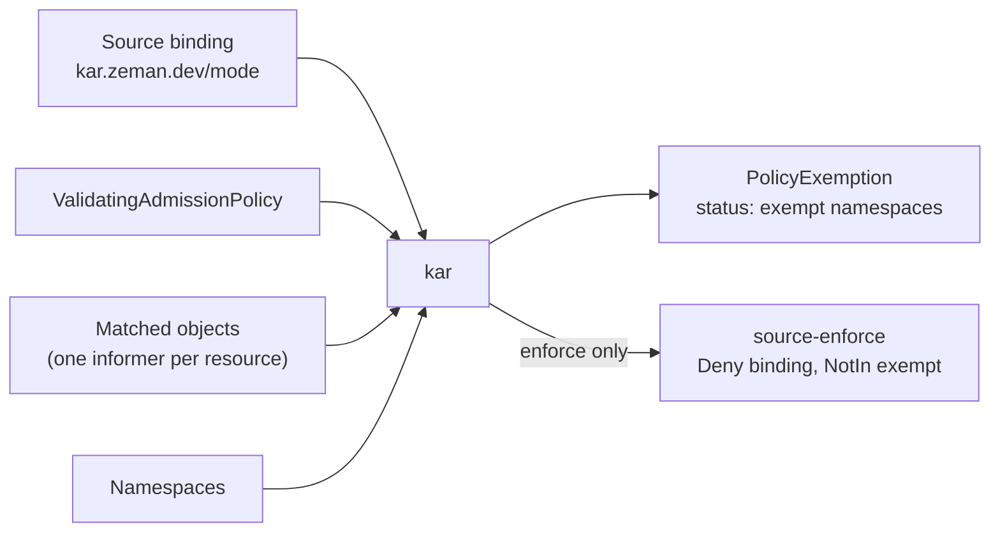

<p align="center">
  <picture>
    <source media="(prefers-color-scheme: dark)" srcset="assets/kar-logo-dark.svg">
    
  </picture>
</p>

# kar - Kubernetes Admission Rollout

[](https://github.com/zemanlx/kar/actions/workflows/ci.yml)
[](https://github.com/zemanlx/kar/blob/main/LICENSE)

`kar` audits existing cluster resources against opted-in `ValidatingAdmissionPolicy` bindings. It maintains a generated Deny binding that exempts namespaces with violations for a TTL, so a policy can be enforced without breaking workloads that already violate it.

Opt in on a `ValidatingAdmissionPolicyBinding` with annotations:

- `kar.zeman.dev/mode: observe|enforce`
- `kar.zeman.dev/ttl`: a Go duration (default `192h`, 8 days)

`kar` supports **Kubernetes 1.36 and 1.37**. A Kubernetes minor version stays
supported until it reaches its [upstream end of life](https://kubernetes.io/releases/).
Every supported minor is checked in CI (see [Testing](#testing)).

## Install

```bash
helm install kar oci://ghcr.io/zemanlx/charts/kar --version 0.1.0 -n kar-system --create-namespace
```

The image `ghcr.io/zemanlx/kar` is built for `linux/amd64` and `linux/arm64`. The image and the chart carry GitHub build provenance attestations:

```bash
gh attestation verify oci://ghcr.io/zemanlx/kar:0.1.0 --owner zemanlx
gh attestation verify oci://ghcr.io/zemanlx/charts/kar:0.1.0 --owner zemanlx
```

The ClusterRole grants get/list/watch on every resource, Secrets included, because the audit reads whatever a policy matches. To grant less, set `rbac.rules`, or set `rbac.create: false` and bind a ClusterRole you already have. See [Configuration](#configuration).

Helm installs `charts/kar/crds/` on first install only. It never upgrades or deletes CRDs, so on upgrade apply the new chart's CRDs first: `helm pull oci://ghcr.io/zemanlx/charts/kar --version <version> --untar` and `kubectl apply -f kar/crds/`.

## Quick start

After Install, apply a policy and a binding with `kar.zeman.dev/mode: observe`. The example leaves out `kar.zeman.dev/ttl`, so the chart's default (`192h`) applies. A missing, invalid or non-positive TTL falls back to that default; set the annotation only when you want a different duration.

Leave it in `observe` for one TTL, then switch to `enforce`. While observing, kar records every namespace that stores a violator and writes no Deny binding, so creates still succeed. A violating create that happens only after `enforce` is denied and never stored, so that namespace is never added to the exemption list. One full TTL gives periodic workloads a chance to run and be recorded first.

```yaml
apiVersion: admissionregistration.k8s.io/v1
kind: ValidatingAdmissionPolicy
metadata:
  name: require-owner
spec:
  failurePolicy: Fail
  matchConstraints:
    resourceRules:
    - apiGroups: ["apps"]
      apiVersions: ["v1"]
      operations: ["CREATE", "UPDATE"]
      resources: ["deployments"]
  validations:
  - expression: "has(object.metadata.labels) && 'owner' in object.metadata.labels"
    message: "deployments need an owner label"
---
apiVersion: admissionregistration.k8s.io/v1
kind: ValidatingAdmissionPolicyBinding
metadata:
  name: require-owner
  annotations:
    kar.zeman.dev/mode: observe
spec:
  policyName: require-owner
  validationActions: [Warn]
```

kar writes a `PolicyExemption` named after the source binding. In `observe` the `Enforcing` column stays False, because there is no Deny binding yet:

```bash
kubectl get policyexemption require-owner
```

```text
NAME            ENFORCING   AGE
require-owner   False       12s
```

Namespaces that violate are listed under `status.namespaces`, each with when it was first seen and when the exemption expires (one TTL after kar last saw a violator there):

```bash
kubectl get policyexemption require-owner -o yaml
```

```yaml
status:
  namespaces:
  - name: legacy-app
    firstSeen: "2026-10-21T09:00:00Z"
    expiration: "2026-10-29T09:00:00Z"
  conditions:
  - type: Auditable
    status: "True"
    reason: Auditable
  - type: Enforcing
    status: "False"
    reason: Observe
  - type: Synced
    status: "True"
    reason: Synced
```

After one TTL (8 days by default), `kar` should collect all exemptions and you can switch the same binding to `enforce`:

```bash
kubectl annotate validatingadmissionpolicybinding require-owner kar.zeman.dev/mode=enforce --overwrite
```

`Enforcing` becomes True, and kar writes a Deny binding named `<source>-enforce`. Its namespace selector excludes the exempt namespaces (`NotIn`):

```bash
kubectl get validatingadmissionpolicybinding require-owner-enforce -o yaml
```

Fix the violators and let the exemptions expire. See [How it works](#how-it-works) for the full lifecycle and [What kar can audit](#what-kar-can-audit) for policies kar cannot evaluate.

## How it works



1. **Opt in.** You annotate a `ValidatingAdmissionPolicyBinding` (the source binding) with `kar.zeman.dev/mode`. kar compiles its policy with Deny semantics using [kat](https://github.com/zemanlx/kat)'s evaluator, the API server's own admission code.
2. **Audit.** kar runs one informer per resource the policy matches. Each object is evaluated once, as its watch event arrives, as if it were being created. kar keeps only a small stub per object (name, namespace, resourceVersion and, for violators, the denying binding and message), and an index of violators per binding and namespace.
3. **Exempt.** A namespace with at least one violator is exempt. kar records it in a `PolicyExemption` named after the source binding, with when it was first seen and when the exemption expires.
4. **Enforce.** In `enforce` mode kar also writes a Deny binding named `<source>-enforce` (a name too long for that is shortened with a hash suffix): the same policy and match as the source binding, plus a `kubernetes.io/metadata.name NotIn [exempt namespaces]` namespace selector. New violations are denied everywhere except the exempt namespaces, where the source binding's own actions (for example `Warn`) still apply. In `observe` mode kar writes no Deny binding.
5. **Expire.** The TTL slides: a namespace stays exempt until one TTL after kar last saw a violator in it. Once a minute kar refreshes the exemptions of namespaces that still have violators, from the in-memory index, and drops namespaces that have expired or been deleted. Then it updates the status and the Deny binding.

What makes kar re-evaluate:

| Change | What kar does |
| --- | --- |
| An object is created, updated or deleted | Evaluates it as the event arrives. A new violator exempts its namespace at once, so short-lived objects are not missed. |
| A namespace's labels change | Re-lists the watched resources in that namespace only, since a `namespaceSelector` or `namespaceObject` can flip a verdict. |
| The policy, the source binding or the params it reads change | Starts a new informer for each affected resource and swaps it in once it has synced, so there is no gap. |

Ownership and failure handling:

- The `PolicyExemption` and the Deny binding are owned by the source binding. Removing the mode annotation makes kar delete them, and deleting the source binding lets the garbage collector delete them even when kar is down.
- A policy kar cannot audit gets `Auditable=False` and no Deny binding. See [What kar can audit](#what-kar-can-audit).
- The `PolicyExemption` status is kar's durable state. A new leader recovers the exemptions from it and from the Deny binding, then refreshes them on its first pass.

## What kar can audit

kar evaluates objects that already exist, so there is no real admission request behind them. It evaluates each object as if it were being created, and supplies what can be derived from the object and the cluster:

| CEL input | Value in the audit |
| --- | --- |
| `object` | the object as stored |
| `namespaceObject` | the object's Namespace, with its current labels |
| `params` | resolved from the source binding's `paramRef`, as the API server does |
| `request.name`, `request.namespace`, `request.kind`, `request.resource` | taken from the object |
| `variables` | evaluated from the above |

Some inputs exist only in a real request. kar does not fake them, because a policy that reads one could give a different answer for the real requester, and kar would miss violators that enforcement then denies:

| CEL input | Why kar cannot supply it |
| --- | --- |
| `request.userInfo` | kar does not know who created or will next update the object. |
| `authorizer` | Authorization checks are about the requester, who is unknown. |
| `oldObject` | Only UPDATE and DELETE have one; an existing object has no "before". |
| `request.operation` | The audit is always CREATE; real requests can be UPDATE or DELETE. |
| `request.dryRun` | Only a real request has it. |

A policy is not auditable when:

- `matchConstraints` does not match CREATE, or
- any validation `expression` or `messageExpression`, `auditAnnotations` value, `matchConditions` expression or `variables` expression reads one of the inputs above, or
- such an expression uses `request` other than by naming a field (for example `cel.bind(r, request, ...)` or a computed key), since kar then cannot tell which fields it reads, or
- such an expression cannot be parsed, or
- the API server would reject the policy.

kar then sets two conditions on the binding's `PolicyExemption`, both with reason `NotAuditable` and a message naming every problem, for example `validations[0].expression reads request.userInfo; matchConditions[0].expression reads authorizer`:

- `Auditable=False`
- `Enforcing=False`

It watches nothing for that binding and removes its Deny binding, if any. The source binding still applies as written. kar re-checks once a minute and whenever the policy or binding changes, so fixing the policy resumes the audit. See [Observability](#observability) for the other condition reasons.

```bash
kubectl get policyexemption <source-binding> -o jsonpath='{.status.conditions[?(@.type=="Auditable")]}'
```

A common case is a policy that skips system users with a `matchConditions` expression on `request.userInfo`. To audit it, move the exception into the binding, for example with a `namespaceSelector` or `objectSelector`, which kar does evaluate.

Where the audit of an auditable policy still differs from admission:

- **Cluster-scoped objects.** A namespace exemption cannot cover them. kar counts their violations in `kar_violations{namespace=""}`. Enforcement still denies new violating ones.
- **`matchPolicy: Exact`.** kar watches each resource at the first version the rule lists that the cluster serves (the group's preferred version for `"*"`), and the API server converts objects to it, as `matchPolicy: Equivalent` (the default) does at admission. Resources stored once but served in two groups, such as core and `events.k8s.io` Events, are covered because the named group lists every stored object. kar ignores `Exact`, so it audits objects written through other versions or groups that admission would not check; this can exempt a namespace admission would never deny, never the reverse.
- **Subresources.** `pods/exec`, `deployments/scale` and similar exist only as requests, so there is nothing to list.

## Configuration

Chart values (`charts/kar/values.yaml`):

| Value | Default | Meaning |
| --- | --- | --- |
| `image.repository` | `ghcr.io/zemanlx/kar` | Controller image |
| `image.tag` | Chart `appVersion` when empty | Image tag |
| `image.pullPolicy` | `IfNotPresent` | Image pull policy |
| `replicas` | `3` | Deployment replicas |
| `defaultTTL` | `192h` | Passed as `--default-ttl`; used when a binding sets no `kar.zeman.dev/ttl` |
| `resources` | requests `100m` CPU / `512Mi` memory, limit `512Mi` memory, no CPU limit | Pod resources; see [Sizing](#sizing) |
| `rbac.create` | `true` | Create the ClusterRole. `false` only creates the binding |
| `rbac.clusterRoleName` | release name | ClusterRole to bind. Required when `rbac.create` is false |
| `rbac.rules` | get/list/watch on every resource | Replaces that read rule. The write rules stay |

Binary flags (the chart sets `--leader-elect` and `--default-ttl`):

| Flag | Default | Meaning |
| --- | --- | --- |
| `--default-ttl` | `192h` | Exemption TTL when a binding sets no `kar.zeman.dev/ttl` |
| `--metrics-bind-address` | `:8080` | Prometheus metrics listen address |
| `--health-probe-bind-address` | `:8081` | Health and readiness probe listen address |
| `--leader-elect` | `false` | Only one replica reconciles; the chart always enables this |

`rbac.rules` replaces only the read rule. kar still adds the write rules: `ValidatingAdmissionPolicyBindings`, `ValidatingAdmissionPolicies`, `PolicyExemptions` and their status, and `Events`. A policy that matches a kind missing from `rbac.rules` cannot be listed.

```yaml
rbac:
  rules:
  - apiGroups: ["apps"]
    resources: ["deployments"]
    verbs: ["get", "list", "watch"]
```

To use a ClusterRole that already exists, skip creation and name it. That role has to grant the reads your policies need and the writes above; the chart does not add them.

```yaml
rbac:
  create: false
  clusterRoleName: my-kar
```

## Observability

Metrics are served on port 8080:

| Metric | Labels | Meaning |
| --- | --- | --- |
| `kar_violations` | `binding`, `namespace` | Existing objects the source binding's policy denies (`namespace=""` for cluster-scoped) |
| `kar_exempt_namespaces` | `binding` | Namespaces currently exempted |
| `kar_informer_restarts_total` | `resource` | Informers replaced to re-evaluate a watched resource |

Also useful for [Sizing](#sizing): `process_resident_memory_bytes` and `go_memstats_heap_inuse_bytes`.

`PolicyExemption` status carries three conditions:

| Condition | Meaning |
| --- | --- |
| `Auditable` | Whether kar can audit the policy |
| `Enforcing` | Whether a Deny binding is active |
| `Synced` | Whether the status and Deny binding match the in-memory audit |

| Reason | On | Meaning |
| --- | --- | --- |
| `Auditable` | `Auditable=True` | The policy can be audited |
| `NotAuditable` | `Auditable=False`, `Enforcing=False` | The policy cannot be audited; see [What kar can audit](#what-kar-can-audit) |
| `Enforcing` | `Enforcing=True` | The derived Deny binding is in place |
| `Observe` | `Enforcing=False` | Observe mode; no Deny binding |
| `Synced` | `Synced=True` | Exemptions match the audit |
| `StateTooLarge` | `Synced=False` | The API server rejected the status as too large; see [Limits](#limits) |
| `PolicyNotFound` | `Synced=False` | The binding's policy is missing |
| `InformerSyncing` | `Synced=False` | Waiting for the initial list of watched resources |
| `DiscoveryFailed` | `Synced=False` | API discovery failed |
| `InformerFailed` | `Synced=False` | An informer could not be started or restarted |
| `ReadFailed` | `Synced=False` | Reading cluster state failed |
| `ApplyFailed` | `Enforcing=False` | Writing the Deny binding failed |

Logs are JSON on stderr.

## Security

- Image is `scratch` with only the static binary. It runs as `65532:65532`.
- Pod meets Pod Security `restricted`: `runAsNonRoot`, `seccompProfile: RuntimeDefault`, no privilege escalation, all capabilities dropped, read-only root filesystem.
- Service account token is not automounted. A projected token with a 1h expiry is mounted instead.
- `enableServiceLinks: false`.
- Leader election uses a namespaced Role. It grants `create` on Leases (`create` cannot be limited by name) and `get`/`update` only on the Lease `kar.zeman.dev`.
- Cluster-wide writes are limited to `ValidatingAdmissionPolicyBindings` (create, update, patch, delete), `PolicyExemptions` and their status, and `Events` (create, patch). Everything else is read-only.

## High availability

- 3 replicas by default.
- Leader election on Lease `kar.zeman.dev` in the release namespace. Only the leader runs informers and writes.
- The leader releases the Lease on shutdown, so a rolling update or drain hands over in seconds (3.5s measured in e2e). A crashed leader is replaced after the 15s lease duration.
- PodDisruptionBudget: `maxUnavailable: 1`.
- Replicas spread across nodes (`topologySpreadConstraints`, `ScheduleAnyway`).

## Build

```bash
go build -o kar .
./kar --help
docker buildx build -t kar .
```

If the build container cannot resolve DNS, add `--network=host`.

## Sizing

kar keeps a small stub per watched object (name, namespace, resourceVersion and, for violators, the denying binding and message), not the object. Memory scales with the number of objects your policies match, not their size.

Measured with `go test -tags load` against envtest (Kubernetes 1.37.0) on an Intel Core Ultra 7 165H (22 CPUs, 30 GiB RAM). The controller runs in the test process, so memory is the test process's heap:

- `TestLoadPods`: 100,000 realistic Running Pods (6.8 KB JSON each) in 4,000 namespaces, one enforce policy on pods, cold start (also what a new leader goes through). RSS 41 MiB before the policy, peak 234 MiB, live heap 134 MiB (about 1.2 KiB per Pod). The first full pass converged in 63.5s.
- `TestLoadWatchedObjects`: 650,000 ConfigMaps, 439 MiB heap (about 0.68 KiB per object; ConfigMaps make smaller stubs than Pods).
- Idle non-leader replica: about 35 MiB RSS. Leader in e2e (kind) with a handful of policies: 48 MiB RSS.

Defaults (`charts/kar/values.yaml`): requests `cpu: 100m` and `memory: 512Mi`, limit `memory: 512Mi`, no CPU limit.

- The memory request equals the limit, so the scheduler reserves what kar can use and kar is not evicted first.
- No CPU limit. kar is bursty (cold start, failover, informer restart) and reconciles serially, so it rarely uses more than one core. A CFS quota would only stretch failover. If a LimitRange forces a CPU limit, keep it at least 1.

Memory limit ≈ `(40 MiB + 2 KiB × objects your policies match) × 1.3`, rounded up to the next power-of-two MiB. The `2 KiB` per object is deliberately conservative against the measured 0.68 to 1.2 KiB. The default 512Mi covers about 180,000 matched objects.

- Count matched objects per resource a policy matches: `kubectl get <resource> -A --no-headers | wc -l`.
- Policies on pods, events, secrets or `*` dominate. Narrow `matchConstraints` before adding memory.
- Every replica gets the same limit, because any replica can become leader.

Verify on the leader through its metrics (port 8080): `process_resident_memory_bytes` and `go_memstats_heap_inuse_bytes`. Keep RSS under about 70% of the limit, and check again after a failover (the cold-start peak). Set with `--set resources.limits.memory=1Gi,resources.requests.memory=1Gi` on `helm install` or `helm upgrade`.

## Limits

kar never truncates its state. When the API server rejects a `PolicyExemption` status as too large, it keeps the last status, leaves the Deny binding unchanged and sets `Synced=False` with reason `StateTooLarge`.

The limit is etcd's `--max-request-bytes`, 1.5 MiB by default. It is a cluster setting, so kar does not assume a value: it tries the write and reacts to the rejection.

Each exempt namespace costs about `83 + len(name)` bytes of status, so one binding can exempt about `1.5 MiB / (83 + average name length)` namespaces with the default: about 10,770 with 63-character names (the maximum, measured) and about 14,800 with 23-character names. The Deny binding's `NotIn` list is smaller (about 66 bytes per 63-character name).

Each ramp below grows one dimension until a step breaks its budget. The budget is what a user would notice: for namespaces, etcd rejecting the status; for watched objects, a live heap over 460 MiB (90% of the chart's 512Mi limit) or a cold start, which is what a new leader does, over 2 minutes; for bindings, all of them taking over 30s to converge; for change rate, a new violation taking over 10s to be recorded. Same hardware and method as [Sizing](#sizing).

| Dimension | Ramp | Limit |
| --- | --- | --- |
| Exempt namespaces (63-character names), each step relabelled into scope at once | 1,000 to 11,000 | 10,000: every step converges within 6s (10,000 in 3.3s, status 1.46 MB, 64 MiB heap); 11,000 hit `StateTooLarge` |
| Watched objects (ConfigMaps), cold start at each step | 50,000 to 700,000 | 650,000: 439 MiB heap, cold start 50s; 700,000 reach 464 MiB. About 0.68 KiB per object |
| Bindings over the same objects | 50 to 350 | 300: converge in 27.6s, 97 MiB heap; 350 take over 30s. Time grows faster than linearly (10.3s at 200) |
| Change rate (updates of violating objects) | 800, 1,600 updates/s | at least 800: a new violation is still recorded in 0.2s. Above that the test client tops out at about 1,100 updates/s, so kar's limit is unknown |

A new or changed object is evaluated as its watch event arrives, so a new violation is recorded within seconds. A namespace label change makes kar re-list the watched resources in that namespace only, so objects it brings into (or out of) a policy's scope are re-evaluated within seconds.

## Uninstall

`helm uninstall` removes the Deployment and RBAC, but leaves the CRDs and any objects kar created. The `PolicyExemption` and `-enforce` bindings are owned by the source bindings, not by the Helm release, so they stay and the Deny bindings keep enforcing with a frozen exemption list (no TTL expiry without kar).

Before uninstall, remove the mode annotations (or delete the source bindings) so kar deletes the generated objects while it is still running:

```bash
kubectl annotate validatingadmissionpolicybinding <source> kar.zeman.dev/mode-
# wait until the PolicyExemption and <source>-enforce binding are gone, then:
helm uninstall kar -n kar-system
```

Or, after uninstall, delete each `PolicyExemption` and `<source>-enforce` binding by name, or delete the source binding and let garbage collection remove its owned objects.

To remove the CRD as well (this deletes every `PolicyExemption`):

```bash
kubectl delete crd policyexemptions.kar.zeman.dev
```

## Testing

GitHub Actions runs the unit tests, the envtest suite and the kind end-to-end suite on Kubernetes 1.36 and 1.37, golangci-lint and a `go generate ./...` drift check on every push and pull request. Load tests stay local.

The envtest suite includes regression checks (`TestRegression*`) on the per-unit costs behind the limits, so a regression fails CI without the hour-long ramps: status bytes per exempt namespace (budget 160, measured 148.4), Deny binding bytes per namespace (75, measured 67.2), heap per watched object (1.5 KiB, measured 0.57 to 0.76) and heap per binding (0.6 MiB, measured 0.2 to 0.29). The byte sizes are deterministic, so their budgets are tight; heap varies, so its budgets are about 2x the highest measured.

```bash
go test ./...  # unit tests; envtest tests skip without KUBEBUILDER_ASSETS
KUBEBUILDER_ASSETS=<envtest binaries> go test ./...  # envtest suite (~80s without -race; -short skips TTL expiry)
KUBEBUILDER_ASSETS=<envtest binaries> go test -race -count=1 ./...  # ~2.5 min with the race detector
KUBEBUILDER_ASSETS=<envtest binaries> go test -tags load -timeout 90m -run TestLoad -v ./internal/controller/
```

The load ramps take `-args` flags: `-load.step`, `-load.max`, `-load.budget`, `-load.objects.step`, `-load.objects.max`, `-load.policies.step`, `-load.policies.max` and `-load.rate`. `TestLoadPods` takes `-load.pods` (default 100,000), `-load.pods.ns` (4,000) and `-load.pods.heapprofile=<file>`; at full size set `TMPDIR` to a disk with a few GiB free, since envtest's etcd data does not fit a small tmpfs. Each ramp ends with a `limit:` line naming the last step that passed and the budget that stopped it. `-load.strict` turns a breached budget into a test failure, so a single step at 80% of each limit is a full-scale regression run:

```bash
KUBEBUILDER_ASSETS=<envtest binaries> go test -tags load -timeout 90m \
  -v ./internal/controller/ \
  -run 'TestLoadExemptNamespaces|TestLoadWatchedObjects|TestLoadPolicies' \
  -args -load.strict -load.step=8000 -load.max=8000 -load.objects.step=520000 \
  -load.objects.max=520000 -load.policies.step=240 -load.policies.max=240
```

End-to-end tests run on a kind cluster with `hack/e2e.sh`. It needs docker, helm and Go. The script installs pinned kind v0.33.0 into `bin/`, builds the image, creates a kind cluster with 3 workers, installs the chart into a Pod Security `restricted` namespace, and runs the e2e suite (about 2 minutes after the cluster is up).

```bash
hack/e2e.sh
```

- `K8S_VERSION=1.36|1.37` (default `1.37`) picks the node image.
- `KAR_VERSION=0.1.0` tests a published release instead of a local build: the chart from GHCR, which pulls its image from GHCR. The kind nodes need to reach ghcr.io; some VPN clients block that.
- `KEEP_CLUSTER=1` keeps the cluster. Kubeconfig: `bin/e2e-kubeconfig`.
- Extra arguments go to the test binary, e.g. `hack/e2e.sh -test.run=TestHardening`.

Logs land in `bin/e2e-logs/`. kubectl, helm and the tests run in a container on the kind Docker network, because VPN clients can drop the host's route to Docker networks.

## Releasing

Set `version` and `appVersion` in `charts/kar/Chart.yaml` to the new version, merge, then push a tag `v<version>` on a commit CI passed. `.github/workflows/release.yml` fails unless the tag matches both, then publishes the image and chart to GHCR with attestations, creates the GitHub release, and runs the e2e suite against the published chart and image (`.github/workflows/verify-release.yml`, which can also be run by hand for any released version). A tag with a hyphen, such as `v0.2.0-rc.1`, makes a prerelease.
